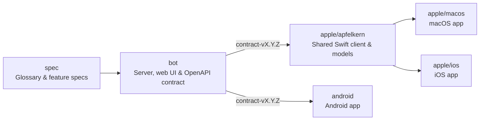

# Crumble specifications

Hand-written product rules, protocols, and feature specifications shared across Crumble repositories.



## Contents

- [Glossary](GLOSSARY.md): canonical domain language for every repository.
- [Features](features/README.md): user-visible capabilities from idea to implementation.
- [Architecture](architecture/README.md): cross-repository boundaries and system structure.
- [Protocols](protocols/README.md): wire behavior and interoperability rules.
- [Authored schemas](schemas/README.md): JSON Schemas for authored specifications.
- [Product brief](product/brief.md) and [parity research](product/parity.md): original product goals and reference capabilities.
- [Contribution guide](CONTRIBUTING.md) and [Changelog](CHANGELOG.md).

## API contract

`bot` owns and publishes the machine-readable API contract as [`contract-vX.Y.Z` releases](https://github.com/crumble-project/bot/releases), containing `openapi.json`, server-sent event JSON Schemas, checksums, and source provenance. See the [contract maintenance guide](https://github.com/crumble-project/bot/blob/main/docs/api-contract.md).

## Validate changes

Requires Bun `1.4.2` and [lychee](https://github.com/lycheeverse/lychee) `0.24.2`:

```sh
bun install --frozen-lockfile
bun run check
lychee --include-fragments --no-progress --exclude-path node_modules '**/*.md'
```
