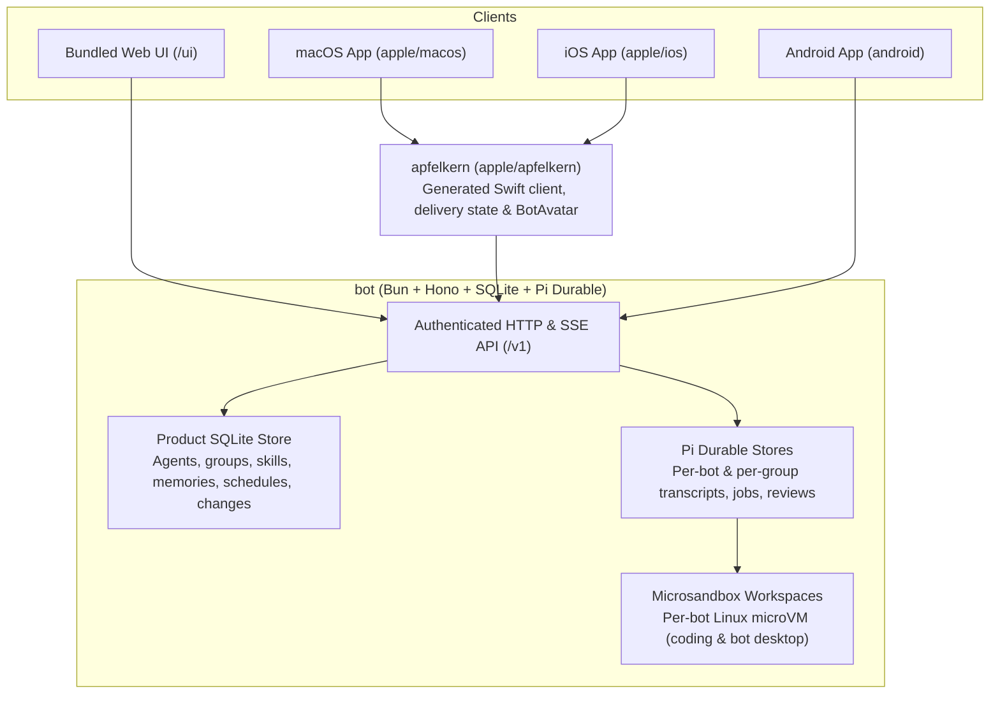

# Architecture

Cross-repository boundaries and responsibilities across the Crumble platform. Repository-local decisions live in each repository's `docs/adr/`.

## Repository boundaries

| Repository | Scope |
| --- | --- |
| `spec` | Canonical [glossary](../GLOSSARY.md), [feature specifications](../features/README.md), and authored schemas. |
| `bot` | Server runtime, Pi Durable orchestration, Microsandbox workspaces, default skills (`skills/`), bundled web UI (`web/`), and the versioned OpenAPI/SSE contract (`openapi/`). |
| `apple` | Shared Swift package (`apfelkern`), native macOS client (`macos`), and native iOS client (`ios`). |
| `android` | Native Kotlin and Jetpack Compose Android client (`android`). |

Follow the [contribution guide](../CONTRIBUTING.md) when proposing cross-repository architecture changes.
