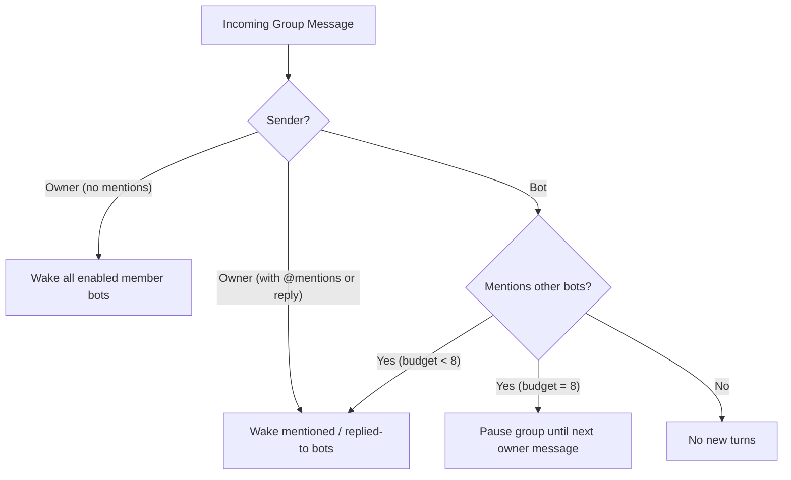

# 0001: Group chats

- Status: Implemented
- Issue: [crumble-project/spec#2](https://github.com/crumble-project/spec/issues/2)
- Repositories: bot, apple (apfelkern, macOS)

## Problem

Bots can message each other one-to-one, but the owner sees that work only as cards in each bot's own chat and cannot bring several bots into one shared conversation.

## Behavior

The owner creates a group chat, names it, and picks two to six bots as members. The owner can add and remove members later:

- A joining bot receives a short summary of the earlier conversation on its first turn, not the full history.
- A removed bot keeps what it saw but receives no new messages, and its active or queued turns stop.
- A disabled member stays listed and is skipped until enabled again; a deleted member leaves the group while its earlier messages keep its name.
- Group chats are separate from each member's private bot chat, and everyone in a group sees one shared transcript with sender attribution.

- A bot answers, reacts with `react`, or stays silent with `pass`.
- A bot may save memories during a group turn only to its own memory (recording the group as its source), not to shared memory.
- In its bot chat, a bot can look up its group chats and read their messages on request.
- The owner is notified when a bot mentions `@owner` and when the first woken bot answers an owner message.
- After eight bot-started turns since the owner's last message, the group pauses until the owner writes again. The owner can also stop all running turns in the group at once.

## Out of scope

- Bots creating group chats, starting coding or desktop jobs from a group turn, or delegating from a group turn.
- Group chats with more than one human.
- iOS and Android clients, which follow in a later specification.

## Acceptance criteria

- The owner can create, rename, update membership (2–6 bots), and delete a group chat; the group and transcript survive restarts.
- Mentioning or replying wakes only the targeted bots; an owner message without mentions wakes every enabled member; a bot message without mentions starts no turns.
- Each bot runs at most one turn per group at a time; further mentions coalesce into one follow-up turn.
- The group pauses after eight bot-started turns and resumes on the owner's next message; stopping the group cancels active and queued turns.
- Interrupted turns resume or fail visibly without posting duplicate messages.
- Private working context and memories never leak to other members; group memories are scoped to the bot and record their source.
- In its bot chat, a bot can list its groups and read their transcripts.
- Notifications fire only for `@owner` mentions and the first bot answer to each owner message.

## API and contract

Shipped across Contracts `1.1.0`–`1.3.0`:

- `/v1/group-chats` CRUD, `/v1/group-chats/{id}/chat`, `/v1/group-chats/{id}/history`, `/v1/group-chats/{id}/messages`, `/v1/group-chats/{id}/attachments/{entryId}/{index}`, `/v1/group-chats/{id}/stop`, and `/v1/group-chats/{id}/events` (`group-chat-snapshot.schema.json`).
- `Memory.source` (`MemorySource`) and `ReplyEvent.groupId` / `groupName`.
- Model tools: `pass` (in group turns) and `group_chats` (in bot chats).

## Clients

macOS and the server's bundled web UI (`/ui`) list group chats in their own section and show sender attribution, `@` mention completion, reactions, attachments, disabled/answering member status, the paused state, and a stop control.

## Decisions

- **Separate shared transcript per group (`groups/<id>.sqlite`) + per-member working conversation in each bot's store.** Prevents diverging copies while keeping private working context isolated.
- **Wake by mention + 8-turn budget.** Prevents runaway loops without per-group configuration.
- **No delegation or jobs from group turns.** Keeps group work visible in the transcript and avoids cycles.
- **Summarize earlier history for late joiners.** Keeps new members' working context small while preserving full transcript access.

## Open questions

None.
