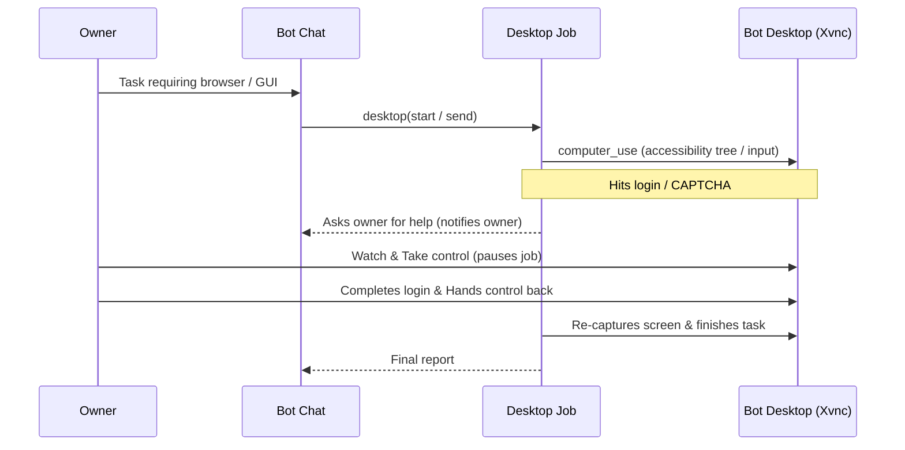

# 0002: Desktop jobs

- Status: Implemented
- Issue: [crumble-project/spec#6](https://github.com/crumble-project/spec/issues/6)
- Repositories: bot, apple (apfelkern, macOS)

## Problem

Bots can only reach the web through fetch tools and MCP servers, and their workspace has no screen. Work that requires a browser with JavaScript, forms, logged-in sessions, or GUI desktop applications had to be done manually by the owner.

## Behavior

The owner can enable a **bot desktop** for a bot (Chromium, Openbox, tint2, and Xvnc inside the bot's Microsandbox workspace) and optionally choose a dedicated `desktopModel`.

- In its bot chat, the bot delegates GUI work to a **desktop job** (`desktop` tool), which operates the bot desktop one job at a time using `computer_use` (accessibility tree first, screenshots as fallback) and reports its answer back to the bot chat as a card.
- Files and browser logins persist across jobs and restarts inside `/workspace`.
- The owner can watch the bot desktop live and **take control** at any time. While the owner holds control, the desktop job waits and only the owner's pointer, keyboard, and clipboard input reach the bot desktop.
- When control returns to the bot, any action planned before the takeover is discarded and the job must capture the screen again first.
- When a job encounters a login, CAPTCHA, payment, or unresolved decision, it stops and asks the owner, triggering a notification that opens the bot desktop.

## Out of scope

- Watching and taking control from iOS and Android (deferred to a later specification).
- Starting desktop jobs from group chat turns.
- Multiple bot desktops per bot, shared bot desktops, Windows/macOS guests, or audio/video streaming.

## Acceptance criteria

- The owner can enable/disable a bot desktop and select `desktopModel` per bot; bots without it have no `desktop` tool and boot the base workspace image.
- A desktop job can open URLs, read accessibility trees, fill/submit forms, operate native GTK dialogs, and report back to the bot chat, without shell, delegation, scheduling, or MCP access.
- Only one desktop job runs on a bot's desktop at a time; subsequent deliveries wait in line.
- Watching alone blocks all viewer input; taking control routes owner pointer, keyboard, and clipboard input to the bot desktop, pauses the job, and survives client disconnects and server restarts.
- Returning control invalidates pre-takeover snapshots and requires a fresh screen capture before further job actions.
- Single-use viewer tickets expire after one minute or on first WebSocket connection.
- Browser sessions and `/workspace` files survive bot desktop and server restarts; idle desktops stop only when neither a job nor the owner is using them.

## API and contract

Shipped across Contracts `1.4.0`–`1.6.0`:

- `Capabilities.desktop` and `Agent.desktopModel`.
- `GET /v1/agents/{id}/desktop-jobs` and `GET /v1/agents/{id}/desktop-jobs/{name}/history` (including per-job token and cost `usage`).
- `GET` and `PUT /v1/agents/{id}/desktop/control`, `GET /v1/agents/{id}/desktop/events` (`desktop-control.schema.json`), and `POST /v1/agents/{id}/desktop/viewer` (serving `/desktop-viewer/{ticket}` over an RFB-filtered WebSocket bridge).
- `ReplyEvent.jobName` and `origin: "coding" | "desktop"` for notifications when a bot answers a job's report.
- Model tools: `desktop` (in bot chats) and `computer_use` (in desktop jobs).

## Clients

macOS and the server's bundled web UI (`/ui`) render desktop job cards with token/cost usage and provide a live bot desktop viewer with **Take Control** and **Hand Back**.

## Decisions

- **Same Microsandbox workspace, two image targets (`base` and `desktop`).** Keeps files, network policy, and lifecycle unified without adding the desktop's footprint (~1 GB image, ~330 MiB RAM with Chromium) to bots that don't use it.
- **Accessibility tree first via `cua-driver` behind one `computer_use` tool.** Uses 2–9× fewer tokens than screenshots in spike benchmarks while keeping screenshot fallback.
- **Server-enforced control lease and RFB input filter.** Drops viewer input unless the owner holds the lease and invalidates stale job actions on every lease change.

## Open questions

None.
