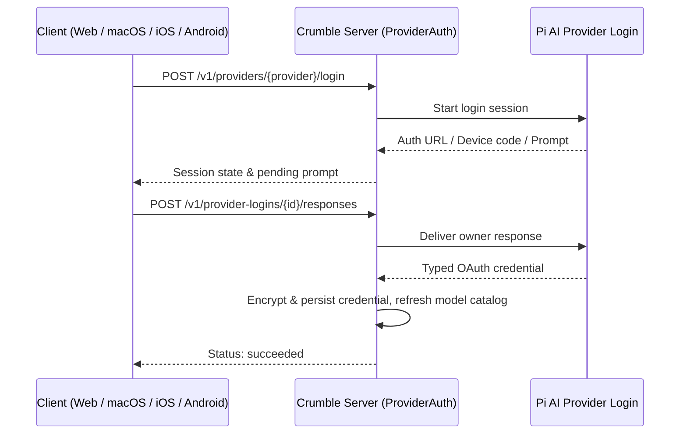

# 0004: Provider account login

- Status: Accepted
- Issue: [crumble-project/spec#7](https://github.com/crumble-project/spec/issues/7)
- Repositories: bot, apple (apfelkern, macOS, iOS), android

## Problem

Owners could only configure provider API keys, not provider subscriptions supported by Pi AI (such as ChatGPT, Codex, Claude, or GitHub Copilot), and needed a way to sign in from a client when the Crumble server runs remotely or in Docker.

## Behavior

Provider settings expose the interactive authentication methods supported by each installed Pi AI provider alongside API keys. Each provider has one saved credential on the server, shared by bots using that provider.

- **Interactive steps:** Clients render authorization URLs, device verification codes, progress messages, and text, secret, selection, or manual-callback-URL prompts.
- **Remote servers:** Device-code flows and manual callback URL pasting allow sign-in when the browser and server run on different machines (except Radius browser sign-in, which requires its device-code option remotely).
- **Session lifecycle:** One active login session per provider; sessions survive temporary client disconnects and expire after 10 minutes idle, 30 minutes total, or a server restart. Failed or cancelled logins leave any existing credential intact.
- **Typed credentials and refresh:** The server stores typed credentials encrypted at rest in `provider_credentials` and serializes logins, token refreshes, key updates, and sign-outs per provider so stale operations never overwrite newer state.

## Out of scope

- Implementing custom OAuth flows outside Pi AI or supporting multiple accounts per provider.
- Importing credentials from local CLI files or changing MCP server OAuth.

## Acceptance criteria

- Provider settings reflect installed Pi AI authentication methods without a hard-coded provider list.
- Owners can complete remote account login (including OpenAI manual callback and Codex device code) without container shell or file access.
- Success is reported only after credential persistence and model catalog refresh; cancellation, failure, and expiration preserve existing credentials.
- Reconnecting recovers an active session; server restarts invalidate pending sessions with `410` while keeping saved credentials.
- Concurrent bot turns share a single serialized token refresh per provider, and sign-out cannot be undone by an in-flight refresh.
- Tokens and submitted secrets never appear in API responses, logs, or transcripts.

## API and contract

Shipped in `bot` Contract `1.7.0`:

- `Provider` adds `authMethods`, `credentialType`, and `activeLoginId`.
- `POST /v1/providers/{provider}/login`, `GET` and `DELETE /v1/provider-logins/{id}`, and `POST /v1/provider-logins/{id}/responses` (`ProviderLoginSession`, `ProviderLoginPrompt`, `ProviderLoginEvent`).
- `DELETE /v1/providers/{provider}` removes either an account credential or an API key.

## Clients

Implemented in `bot` (including the bundled web UI at `/ui`), `apple/apfelkern`, and `apple/macos`. `apple/ios` and `android` follow.

## Decisions

- **Reuse Pi AI's provider-neutral interaction protocol.** Supports all Pi AI OAuth providers without per-provider client releases.
- **Keep credentials and refresh on the server.** Clients only relay interactive sign-in steps over the authenticated server connection.
- **Serialize mutations per provider.** Prevents race conditions between concurrent refreshes, replacement logins, and sign-out.

## Open questions

None.
