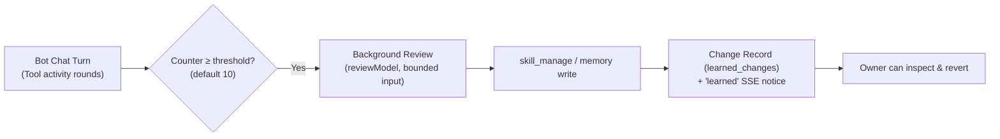

# 0005: Learned skills

- Status: Accepted
- Issue: [crumble-project/spec#8](https://github.com/crumble-project/spec/issues/8)
- Repositories: bot, apple (apfelkern, macOS, iOS), android

## Problem

Skills were static text edited only by the owner and inlined into every turn, while memory held a flat list of facts. Bots could not capture reusable procedures, pitfalls, or owner corrections from their work.

## Behavior

Skills act as on-demand procedural memory that bots load, create, and refine themselves, while every change is recorded and reversible by the owner.

- **On-demand skill packages:** A skill has a `name`, one-line `description`, main `instructions`, and up to 20 optional `references/*.md` documents. Working context lists available skills by name and description; the bot loads a skill or reference document via the `skill` tool only when needed. A bot's own skill shadows a shared skill of the same name, which shadows a bundled default.
- **Self-editing (`skill_manage`):** Bots create, patch, rewrite, and delete their own skills and manage reference documents in atomic batches. Patching or deleting requires loading the skill in the same turn. Bundled defaults and shared skills are read-only to bots (bots shadow them with an own copy).
- **Post-turn background review:** After a bot-chat turn whose tool-activity rounds reach the skill or memory threshold (default 10 rounds since the last write to that store), a background review runs on `reviewModel` (or the bot's model) with only the `skill`, `skill_manage`, and `memory` tools. Its total input across requests is capped at 75% of the model's context window (at most 600,000 tokens, or `review.maxInputTokens`). Scheduled tasks and group turns do not trigger reviews; restarts drop in-flight reviews.
- **Change record and revert:** Every skill or memory write by the owner, a bot, a review, or the curator records the actor, source execution, and before/after state. Owners can revert any change. When a review records changes, the chat receives a `learned` event notice.
- **Curator lifecycle:** Bot-created skills unused for 14 days become `stale` and at 30 days become `archived` (leaving the working context list until restored by the owner). Pinned skills and skills referenced by scheduled tasks are never archived.

## Out of scope

- Executable scripts inside skill packages, external skill registries, pre-write approval queues, or model-driven skill consolidation.
- Reviews after group turns, coding jobs, desktop jobs, or scheduled tasks.

## Acceptance criteria

- Working context lists skills by name and description only; `skill` loads instructions and `references/*.md` on demand and increments usage.
- `skill_manage` enforces read-before-modify, validates names/sizes/paths, returns non-blocking quality advisories, and restricts bot writes to the bot's own skills.
- Background reviews fire when tool-activity counters reach threshold, reset counters on direct writes, obey the token budget and tool whitelist, and drop cleanly on restart.
- Every skill and memory mutation is logged with before/after state and can be reverted via the API.
- The curator transitions unused bot-created skills to `stale` (14d) and `archived` (30d) while respecting pins and scheduled tasks.

## API and contract

Shipped in `bot` Contract `1.9.0` (see `bot/docs/adr/0003-learned-skills.md`):

- `GET` and `POST /v1/agents/{id}/skills`, `PATCH` and `DELETE /v1/agents/{id}/skills/{skillId}`, and `GET /v1/skills/{id}` returning `SkillPackage` (`Skill` plus `agentId`, `description`, `documents`, `createdBy`, `sourceExecutionId`, `useCount`, `lastUsedAt`, `state`, `pinned`).
- `Agent.skills` remains a `{ name, instructions }` view (up to 100 entries) backed by the `skills` table so existing Contract 1.x clients preserve package metadata when saving agents.
- `Agent.review` and `Agent.reviewModel` configuration.
- `GET /v1/changes`, `POST /v1/changes/{id}/revert` (`LearnedChange`, `ChangeSource`), `GET /v1/agents/{id}/reviews` (`ReviewResult`), and the `learned` SSE event on `GET /v1/events` (`learned-event.schema.json`).
- Model tools: `skill` and `skill_manage`.

## Clients

Implemented in `bot`. Native client updates in `apple` (`apfelkern`, `macos`, `ios`) and `android` follow.

## Decisions

- **Skills for procedures, memory for universal facts.** On-demand skill packages scale without bloating every turn's context.
- **Reversible change log instead of approval gates.** Lets bots improve autonomously while giving the owner full auditability and one-click revert.
- **Inline `Agent.skills` kept as a database-backed view.** Avoids a breaking contract bump for existing clients.

## Open questions

None.
