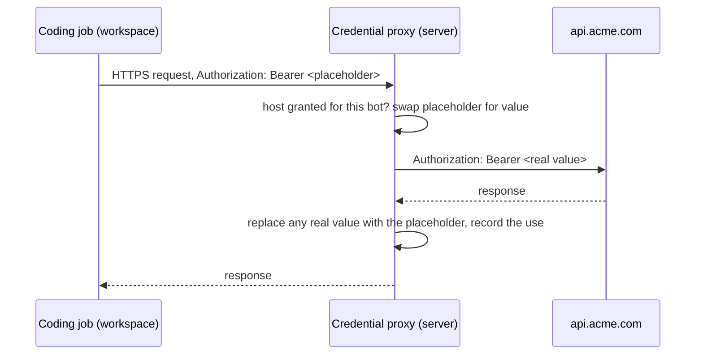

# 0007: Credentials

- Status: Accepted
- Issue: [crumble-project/spec#13](https://github.com/crumble-project/spec/issues/13)
- Repositories: bot, apple (apfelkern, macOS, iOS), android

## Problem

A bot's coding job cannot authenticate to an API that has no MCP server. The only way to hand it a token today would be to put the value in the workspace, where every process can read it, the bot can print it into a transcript, and the workspace's saved disk keeps it. A bot that reads a prompt injection in a web page, an API response, or a cloned repository can send it anywhere: workspaces have open internet and no network policy (bot ADR 0005). Scheduled tasks hit the same wall.

Prompt injection still leads coding agents to exfiltrate data, including in Claude Code, Copilot, and Cursor (CVE-2025-55284, CVE-2025-53773, CVE-2025-54135). Every product that claims the agent cannot steal a secret keeps it outside the machine and adds it at the network edge. Research: `bot/docs/research/workspace-secrets.md`.

## Behavior

A **credential** is a secret value the owner gives one bot for a list of hosts. The bot's jobs use it through a placeholder; the real value never enters the workspace.

### Getting a credential

- **The bot asks when it needs one.** A model tool, `request_credential`, takes a variable name (`ACME_TOKEN`), one or more hosts (`api.acme.com`), and a reason. It records a pending request and returns at once; the bot tells the owner in its chat as usual, which notifies the owner like any reply.
- **The owner answers outside the chat.** The tool activity in the transcript carries an action that opens a credential form with the name, the proposed hosts, and the reason, plus a secret field for the value. The owner can edit the hosts before saving. The value is never typed into a chat composer and never shown again after saving.
- **The bot learns the answer.** Saving a requested credential adds a notice to the bot chat that starts a bot turn, as a finished coding job does. Declining removes the request and adds a notice that says so.
- **The owner can add one directly** in the bot's settings, without a request.

### Using a credential

- **Placeholder in the workspace.** Every command a coding job runs sees each of the bot's credentials as an environment variable whose value is a placeholder: random, per credential, stable until the credential is deleted. The same commands see `HTTPS_PROXY`, `HTTP_PROXY`, `NODE_USE_ENV_PROXY=1` (Node's built-in `fetch` ignores the proxy variables without it), and the CA variables common clients read (`SSL_CERT_FILE`, `REQUESTS_CA_BUNDLE`, `CURL_CA_BUNDLE`, `NODE_EXTRA_CA_CERTS`). Scripts and SDKs that read `ACME_TOKEN` work unchanged.
- **The coding job knows its credentials.** Its instructions list the bot's credentials with their hosts, and say they work only through the proxy, so an authentication error from a client that bypasses it points the job at the cause.
- **The proxy swaps it on granted hosts only.** The credential proxy runs on the server, one per running workspace. For a host on one of the bot's credentials it terminates TLS with the bot's CA, replaces that credential's placeholder in request headers (including inside HTTP Basic authorization) and in the query string, and forwards the request over verified TLS. Traffic to every other host is tunneled through untouched and uninspected, so the proxy is not a network policy and adds no approvals.
- **A placeholder is worthless anywhere else.** The proxy accepts placeholders only on connections from the bot's own workspace. A placeholder sent to another host, sent from another bot's workspace, copied from a transcript, or sent around the proxy reaches its destination as the placeholder.
- **Responses are scrubbed.** The proxy replaces the real value with the placeholder in response headers and in text bodies, so an API that echoes the request cannot hand the value back.
- **Every swap is recorded:** time, method, host, path, and response status. Records do not name the coding job: jobs share one workspace, so a connection cannot be traced to one. The owner sees the latest use on each credential and the list per credential. Records are kept for 90 days and never contain the value.
- **Scheduled tasks** need nothing extra: they run as the bot, and so do their coding jobs.

### Managing credentials

- Bot settings list the bot's credentials and pending requests: name, hosts, created, last used. Values are write-only.
- **Replacing the value** applies from the next request; the placeholder stays the same.
- **Changing hosts** applies from the next connection.
- **Deleting** stops swapping at once; running jobs keep the variable but it no longer works, and later jobs no longer see it.
- Duplicating a bot does not copy its credentials. Deleting a bot deletes its credentials and their records.

### Workspace backends

- **Microsandbox:** every outbound connection already goes through the per-workspace proxy (`workspace-proxy.ts`); the credential proxy is that proxy, extended. A tool that ignores `HTTPS_PROXY` still goes through it.
- **Railway:** there is no egress hook. The proxy is reached through a guest listener on `127.0.0.1` that carries connections over the exec stream, as Xvnc is reached today, with no port exposed. A tool that ignores `HTTPS_PROXY` connects directly and sends only the placeholder, which fails.
- **CA:** each bot has its own CA, generated by the server, with the private key only on the server. Its certificate is uploaded at every boot and trusted by the system store and by Chromium's certificate store in the bot desktop, so a granted host opened in the browser loads without a certificate error.

## Out of scope

- **Plaintext credentials:** a value inside the workspace for things that are not HTTP, such as signing keys, database passwords, and SSH keys, for example through a `run` wrapper that injects the value into one process. That cannot stop a prompt-injected bot (research, Recommendation) and needs its own specification once a real case asks for it.
- Request signing (AWS SigV4), OAuth flows the proxy would run, and minting short-lived tokens.
- Method and path rules per credential.
- Shared credentials available to several bots.
- Body substitution and plain HTTP: a placeholder in a request body or in an unencrypted request is not swapped.
- Hosts on private or loopback addresses: the proxy forwards credentials only to public addresses.
- Logins typed into the bot desktop's browser. Desktop jobs do not see the variables.
- A network policy or per-request approvals.

## Acceptance criteria

Offline, against a fake upstream with a test certificate authority:

- A coding job's `curl -H "Authorization: Bearer $ACME_TOKEN" https://api.acme.com/...` reaches the upstream with the real value; the same with the token in a query parameter and in HTTP Basic authorization.
- The workspace never holds the value: not in any job's environment, not on disk, not in a transcript, tool result, log, API response, or use record.
- The same placeholder sent to a host not on the credential reaches that host unchanged.
- A placeholder sent from another bot's workspace reaches the upstream unchanged.
- An upstream that echoes request headers and body returns the placeholder, not the value.
- Traffic to hosts without a credential is not intercepted: a client that pins its own certificate still connects.
- A credential host that resolves to a private or loopback address gets no value; the request fails with a proxy error.
- `request_credential` with a reserved variable name (`PATH`, `HOME`, the proxy and CA variables, any `CRUMBLE_` name) or without a host is refused with a message.
- Saving a requested credential starts a bot turn with the notice; declining starts one that says so.
- Replacing a value, changing hosts, and deleting take effect as described in Managing credentials, including for a job that is running.
- After a server restart the credentials and their records are intact, and a reconnected Railway workspace gets its proxy back without restarting the machine.
- A workspace that boots while the proxy cannot start fails the job with that reason instead of running without credentials.
- A Node script using the built-in `fetch`, a Python script using `requests`, and `curl` each reach the upstream with the real value on both backends.
- On a Microsandbox bot desktop, Chromium opens a granted host without a certificate error.
- Use records older than 90 days are removed.
- Both backends pass the same tests. On Railway, a request that bypasses the proxy carries only the placeholder.
- Unit tests need no Railway account, no network, and no real secrets; CI time stays within its two-minute limit. VM tests run locally.

Manual, run by hand with a real model:

- Prompt-injection canary: a bot with a credential for a capture host receives injected instructions in a fetched page, an API response, a repository README, and an email. Over several runs per case, no real value reaches anything but the granted host. The result is recorded with the model and date.

## API and contract

Compatible additions in the next contract 3.x minor version (proposed shape):

- `Credential`: `name`, `hosts`, `createdAt`, `updatedAt`, `lastUsedAt`. No value field in any response.
- `CredentialRequest`: `name`, `hosts`, `reason`, `requestedAt`.
- `GET /v1/agents/{id}/credentials`: the bot's credentials and pending requests.
- `PUT /v1/agents/{id}/credentials/{name}`: create or update with `hosts` and, when creating or replacing, `value`. Saving answers a pending request of the same name.
- `DELETE /v1/agents/{id}/credentials/{name}`: delete a credential or decline a pending request.
- `GET /v1/agents/{id}/credentials/{name}/uses`: paged use records.
- Model tool `request_credential(name, hosts, reason)`. Its tool activity in the transcript names the request, so clients can show the action.

## Clients

- **Web UI (bot), macOS and iOS (apfelkern):** a Credentials section in bot settings with the list, pending requests, the credential form, and the use list. The `request_credential` tool activity in the transcript shows an action that opens the form.
- **Android:** the same, in its bot settings, when Android ships them.
- Clients without the contract addition show `request_credential` as ordinary tool activity; the owner adds the credential in the web UI.

## Decisions

- **Placeholders and a server-side proxy, not values in the workspace.** The bot may be prompt-injected and the workspace has open internet, so any value inside it can leave. Rejected: passing values as environment variables (Copilot, Cursor, Devin, Modal), which only masks output.
- **The bot requests, the owner answers.** Nothing to set up beforehand. The host list is the owner's one judgment: it stops a manipulated bot from asking for the value to be sent to a host it controls.
- **Credentials are a bot's own.** A grant to one bot keeps the placeholder binding and the use records simple. Shared credentials can follow.
- **One proxy for both backends, built in bot.** Railway needs a Crumble-run proxy anyway, and Microsandbox's built-in secrets read values from the host environment at sandbox start, which fits per-bot values poorly. Rejected: iron-proxy as a subprocess, because tying a token to one workspace is unverified.
- **Intercept only granted hosts.** Inspecting every connection would break clients that pin certificates and turn the proxy into a network policy. A placeholder sent elsewhere is harmless because it only works on the bot's own connection, so it is not blocked.
- **Headers and query by default, no body.** Covers bearer tokens, API-key headers, Basic authorization, and `?api_key=` APIs without per-credential settings. Echoed query strings are handled by scrubbing responses.
- **No output redaction.** The value never enters the workspace and responses are scrubbed, so there is nothing for a redactor to catch; redaction belongs to plaintext credentials.
- **Proxy variables plus job instructions, not proxy enforcement on Railway.** Railway has no egress hook. Python, curl, Bun, and Go honor the proxy variables; Node's `fetch` does with `NODE_USE_ENV_PROXY=1` (tested on Node 26.10). Clients that still bypass the proxy fail closed with the placeholder, and the job's instructions name the likely cause.
- **Use records for 90 days.** Long enough to investigate misuse after the fact, bounded for scheduled tasks that call an API often.

## Open questions

None.

Verified during implementation, not blocking: the Node version on Railway's base image supports `NODE_USE_ENV_PROXY`, and Microsandbox desktop images serve their browser through the extended proxy unchanged (both covered by acceptance criteria).
