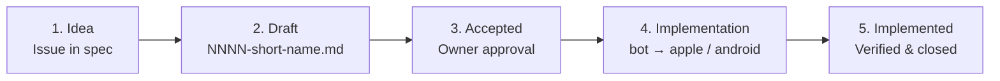

# Features

A feature specification describes one user-visible capability across every repository it touches.

## Lifecycle

1. **Idea.** Open an issue in this repository with the idea form.
2. **Draft.** Copy [TEMPLATE.md](TEMPLATE.md) to `NNNN-short-name.md`, link the issue, and settle new terms in the [glossary](../GLOSSARY.md).
3. **Accepted.** The owner approves the specification. Nothing is built from a draft.
4. **Implementation.** Split work into milestones in contract order: `bot` and its contract release, then `apple` (`apfelkern`, `macos`, `ios`) and `android`. Every pull request links the specification.
5. **Implemented.** Every acceptance criterion is verified, changelogs are updated, and the idea issue is closed.

Record cross-repository technical decisions in [architecture](../architecture/README.md) and repository-local decisions in that repository's `docs/adr`.

## Index

- [0001: Group chats](0001-group-chats.md): Implemented
- [0002: Desktop jobs](0002-desktop-jobs.md): Implemented
- [0003: Chat history search](0003-chat-history-search.md): Implemented
- [0004: Provider account login](0004-provider-account-login.md): Accepted
- [0005: Learned skills](0005-learned-skills.md): Accepted
